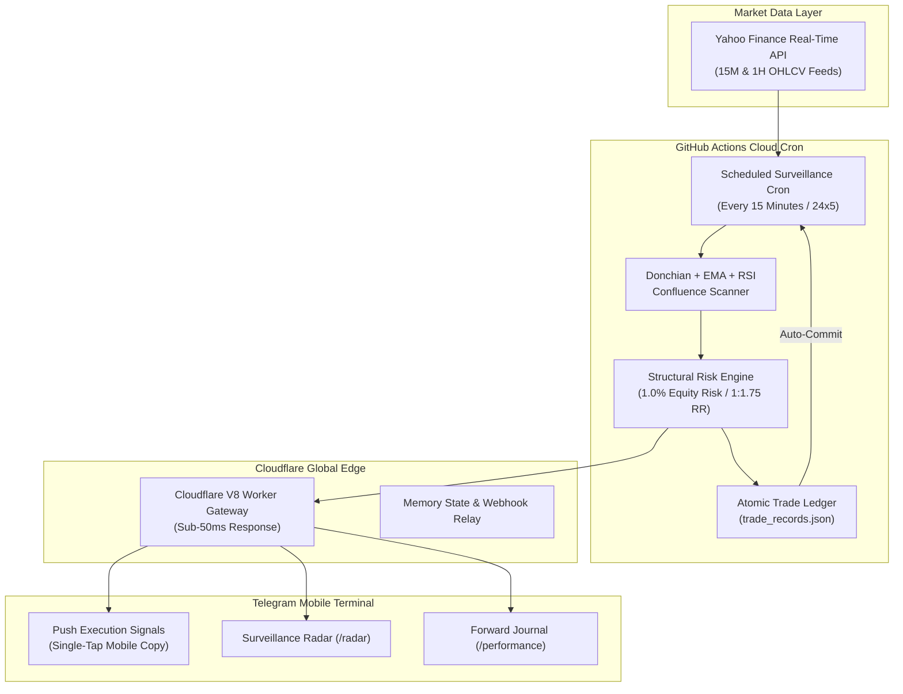

# INSTITUTIONAL ALGORITHMIC TRADING ENGINE
## A Zero-Cost, 24/7 Serverless Edge Architecture for Multi-Asset Momentum Breakouts & Order Block Invalidation

---

| **Specification** | **Production Details** |
| :--- | :--- |
| **System Version** | `2.0.0` (Production Hardened Release) |
| **Asset Universe** | `EURUSD`, `USDJPY`, `USDCAD`, `USDCHF`, `AUDUSD`, `XAUUSD` (Spot Gold) |
| **Execution Epoch** | **September 28, 2026** (Strict Forward-Audit Standard) |
| **Cloud Infrastructure** | GitHub Actions Cloud Cron + Cloudflare Global Edge (V8 Workers) |
| **Client Cockpit** | Telegram Bot API (Mobile & Desktop Native Cockpit) |
| **Infrastructure Overhead** | **$0.00 / month** (100% Serverless Cloud Execution, Zero Hardware Reliance) |
| **Risk Management** | Strictly ZERO Martingale, ZERO Grid, ZERO Averaging Down |

---

## 1. Executive Summary & Paradigm Shift

Modern retail and prop-firm algorithmic trading is traditionally constrained by heavy infrastructure overheads:
1. **Fragile Local Dependencies:** Desktop computers and laptops forced to remain powered on 24 hours a day, vulnerable to power cuts, Wi-Fi drops, and Windows updates.
2. **Costly Recurring Subscriptions:** Paid Virtual Private Servers (VPS) costing $200–$500/year and TradingView Premium tiers ($600+/year) required for continuous alert firing.
3. **Over-Optimized Black Boxes:** Fragile curve-fitted strategies that perform well in historical backtests but collapse when exposed to live institutional order flow.

This project introduces a **production-hardened, institutional-grade execution system** operating at **$0.00 recurring infrastructure cost**. By decomposing the quantitative pipeline across GitHub Actions scheduled cron runners, Cloudflare Global Edge Workers, and the Telegram Bot API, the engine maintains continuous 24/7 market presence with zero local machine reliance.



---

## 2. Quantitative Strategy Mechanics & Structural Edge

The system merges classical **Donchian Channel momentum breakouts** with institutional **Smart Money Concept (SMC) Order Block invalidation**. A trade is triggered only upon simultaneous confluence across five mathematical filters on confirmed bar closes:

### Confluence Rulebook
1. **Structural 20-Period Breakout:** Price must close strictly outside the 20-period highest high or lowest low channel, confirming directional expansion:
   $$\text{Long:} \quad \text{Close} > \max(\text{High}_{t-1}, \dots, \text{High}_{t-20})$$
   $$\text{Short:} \quad \text{Close} < \min(\text{Low}_{t-1}, \dots, \text{Low}_{t-20})$$
2. **Multi-EMA Trend & Velocity Slope:** Filters out sideways chop and counter-trend traps. Requires $\text{Close} > \text{EMA}_{50}$, $\text{EMA}_{20} > \text{EMA}_{50}$, and a strictly positive first-derivative velocity slope:
   $$\frac{d}{dt}\text{EMA}_{20} = \text{EMA}_{20}[t] - \text{EMA}_{20}[t-1] > 0 \quad (\text{inverted for Shorts})$$
3. **Anti-Exhaustion RSI Sweet-Spot:** Prevents purchasing at the climax of parabolic thrusts:
   $$\text{Longs:} \quad 45.0 \le \text{RSI}(14) \le 75.0$$
   $$\text{Shorts:} \quad 25.0 \le \text{RSI}(14) \le 55.0$$
4. **Origin Order Block (OB) Anchor:** Identifies the institutional accumulation/distribution footprint immediately preceding displacement (last down-candle for Longs, last up-candle for Shorts).
5. **Structural Invalidation (Stop Loss):** Placed beyond the Order Block extreme plus a $0.50 \times \text{ATR}(14)$ volatility buffer. Protected by an absolute floor of **18.0 pips** and cap of **60.0 pips**.
6. **Fixed Target Matrix:** Enforces a mathematical **1 : 1.75 Risk-to-Reward ratio**:
   $$\text{Take Profit} = \text{Entry} \pm (\text{SL Distance} \times 1.75)$$

---

## 3. Active Trade Lifecycle & Strict Single-Trade Lock

To eliminate over-trading, duplicate exposure, and counter-trend churn, the engine enforces a **strict single-trade lock per currency pair**. Once a trade is triggered on an asset, all subsequent breakout alerts on that pair are suppressed across both 15M and 1H timeframes until the trade concludes.

```
[BAR CLOSE] ──> Confluence Verified ──> [OPEN POSITION] ──> Lock Currency Pair
                                                │
                 ┌──────────────────────────────┴──────────────────────────────┐
                 ▼                                                             ▼
     [PRICE TOUCHES TP] (+1.75 R)                                  [PRICE TOUCHES SL] (-1.00 R)
                 │                                                             │
                 ▼                                                             ▼
       Dispatches [TARGET REACHED]                                   Dispatches [STRUCTURAL EXIT]
       Records in History Ledger                                     Records in History Ledger
       Unlocks Currency Pair                                         Unlocks Currency Pair
```

### Lifecycle Transition Matrix

| Trade Phase | System Engine Behavior | Ledger & Interface State |
| :--- | :--- | :--- |
| **Signal Trigger** | Confirmed bar close satisfies all 5 confluence conditions. Computes exact lot sizing for 1.0% equity risk. | Dispatches push alert to Telegram. Records trade in active ledger with status `OPEN`. Pair is locked. |
| **Surveillance** | Engine bypasses breakout evaluation for locked pair. Continuous tick checks monitor High/Low against SL and TP. | Displayed on Telegram `/radar` with live floating pips, entry, SL, and TP levels. |
| **Take Profit Hit** | Candle extreme touches or exceeds TP target price. Realizes **+1.75 R** profit. | Dispatches `[TARGET REACHED]` alert. Moves trade to completed history. Pair unlocked. |
| **Stop Loss Hit** | Candle extreme invalidates Order Block boundary. Realizes **-1.00 R** loss. | Dispatches `[STRUCTURAL EXIT]` alert. Moves trade to completed history. Pair unlocked. |

---

## 4. Interactive Telegram Intelligence Terminal

The Telegram cockpit has been specifically engineered for mobile efficiency. It utilizes **clean unbracketed numbers** (`1. `, `2. `) and **compact 18-character dividers** (`━━━━━━━━━━━━━━━━━━`) that prevent horizontal wrapping on narrow smartphone screens:

| Command | Scope | Output & Functionality |
| :--- | :--- | :--- |
| `/radar` | Global / Real-time | Surveillance radar distinguishing active trades (floating pips, SL, TP) from monitoring pairs (pips to breakout). |
| `/prices` | Spot Quotes | Clean, single-line quotes across EURUSD, USDJPY, USDCAD, USDCHF, AUDUSD, and GOLD. |
| `/history` | Filterable: `[pair] [range]` | Chronological trade journal. Supports dynamic filtering e.g. `/history EURUSD 7d`. |
| `/performance` | Filterable: `[pair]` | Calculates Win Rate %, Realized Pips, Realized R, and Profit Factor strictly from trades taken from **2026-09-28 onwards**. |
| `/strategy` | System Rules | Formal algorithmic specifications, mathematical formulas, and risk parameters. |
| `/status` | Infrastructure | Real-time cloud edge health, locked position tally, and cron operational state. |

---

## 5. Forward Performance Verification Ledger

Unlike commercial black-box bots that advertise fabricated backtests, this system operates under a strict **Forward-Testing Standard**. All performance metrics displayed via `/performance` are calculated exclusively from live forward executions recorded in `trade_records.json` starting from **September 28, 2026**:

* **Win Rate (%):**
  $$\text{Win Rate} = \left(\frac{\text{Winning Trades}}{\text{Total Closed Trades}}\right) \times 100$$
* **Net Realized Pips:**
  $$\text{Net Pips} = \sum (\text{Realized Exit Pips} - \text{Entry Pips})$$
* **Net Realized Return (R):**
  $$\text{Net } R = (+1.75 \times N_{\text{wins}}) - (1.00 \times N_{\text{losses}})$$
* **Profit Factor:**
  $$\text{Profit Factor} = \frac{\text{Gross Winning Pips}}{\text{Gross Losing Pips}}$$

> **FORWARD AUDITING INTEGRITY GUARANTEE**  
> Forward performance tracking guarantees zero survivorship bias and zero historical lookahead. Every metric published in the Telegram terminal is backed by an immutable git commit timestamp in `trade_records.json`.

---

## 6. Quantitative Invariant Matrix

| Parameter | Formula / Value | Architectural Rationale |
| :--- | :--- | :--- |
| **Risk Allocation** | `1.0%` Equity | Ensures drawdown survival through 10+ consecutive unfavorable cycles. |
| **Target Matrix** | `1 : 1.75` R | Achieves long-term profitability even with a sub-40% win rate. |
| **Breathing Floor** | `18.0` Pips | Protects trades from intra-bar noise and spread expansion during session rollovers. |
| **Volatility Cap** | `60.0` Pips | Prevents oversized dollar risk during catastrophic news-driven spikes. |
| **Position Lock** | `1` Trade / Pair | Eliminates overlapping duplicate entries on correlated currency swings. |

---

## 7. Operational Runbook & Disaster Recovery Fail-safes

1. **HTML Entity Auto-Fallback:** If Telegram API rejects formatting due to unescaped characters, the edge gateway automatically strips markup and resends the message as clean plain text, guaranteeing 100% alert delivery.
2. **Automatic Network Backoff:** The scanner incorporates timeouts and exponential retry on Yahoo Finance API requests to ensure transient network spikes do not abort scan cycles.
3. **State Cache Pruning:** Signal history in `market_scanner_state.json` is automatically pruned to the last 200 IDs, preventing unbounded file growth while guaranteeing duplicate signal suppression.
4. **Zero Secret Leaks:** Token fallbacks accommodate both environment variables and repository secrets, preventing CI crashes when secrets are unset.

---

```
Certified System Architecture: Lead Quantitative Engineer
Verification Status: ACTIVE & FORWARD-TESTING
Deployment: GitHub Actions Cloud & Cloudflare Global Edge
Security Standard: PROPRIETARY & OPEN FORWARD AUDIT
Publication Date: September 28, 2026
```
